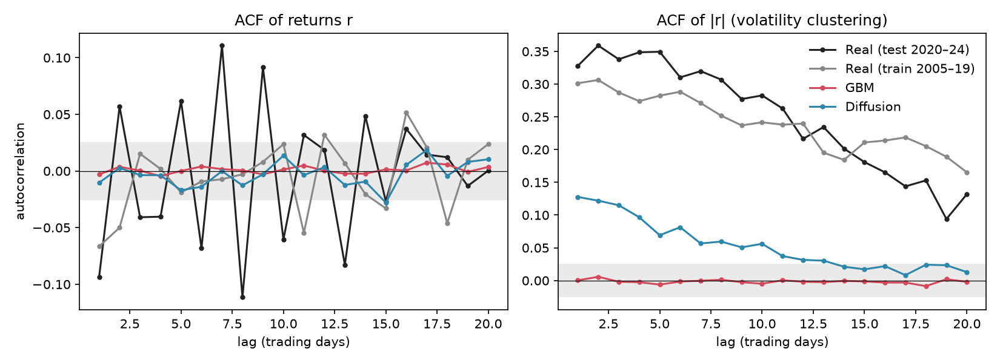
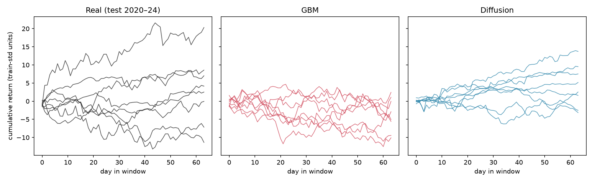
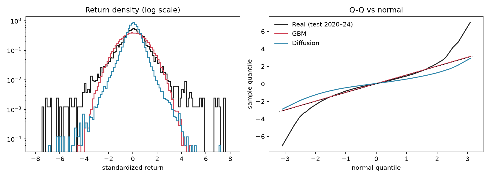

# Synthetic Financial Time-Series via Diffusion

A small diffusion model that generates 64-day paths of daily stock returns, tested against the classical baseline (geometric Brownian motion, GBM) on the statistical fingerprints that real markets leave behind.

**Result in one line:** the model reproduces volatility clustering, fat tails and negative skew far better than GBM does, but it generates returns that are too quiet, and it loses to GBM on overall distance to real data.

**Idea source:** the "Unconditional Generation" section of [Diffusion Models in Finance](https://github.com/ZhuoHan1998/Diffusion-Models-In-Finance). This is original code inspired by that list, not a port of any one paper's repo. See [docs/sources.md](docs/sources.md).

## Contents

1. [Why generate synthetic returns?](#why-generate-synthetic-returns)
2. [The test: volatility clustering](#the-test-volatility-clustering)
3. [Results, including where it falls short](#results-including-where-it-falls-short)
4. [How it works](#how-it-works)
5. [How the results are measured](#how-the-results-are-measured)
6. [Design decisions and what they protect against](#design-decisions-and-what-they-protect-against)
7. [Project layout](#project-layout)
8. [Setup and reproduction](#setup-and-reproduction)
9. [Limitations](#limitations)
10. [What would come next](#what-would-come-next)
11. [Documentation map](#documentation-map)

## Why generate synthetic returns?

- **Backtest augmentation.** History gives one realized path. Plausible alternatives help test whether a trading strategy was just lucky.
- **Stress-testing.** Generate many volatile windows without waiting for the next crisis.
- **Privacy-preserving sharing.** Synthetic data can stand in where real data cannot be shared.

All three only work if the synthetic data behaves like real returns. This project asks how well a small diffusion model manages that, and measures the answer honestly.

## The test: volatility clustering

Real returns have a signature that GBM cannot produce. Calm and wild periods come in streaks, so the size of today's move predicts the size of tomorrow's. GBM draws every day independently, which makes that correlation exactly zero by construction.

GBM is also the classical stochastic-calculus "diffusion". The paper list's own scope note excludes that kind of diffusion, which is why it is the right naive baseline here: it is the thing a *learned* diffusion model has to beat.

Mean autocorrelation of absolute returns over lags 1 to 20, measured on the real 2020–2024 holdout that neither model saw:

| Source | Mean ACF of \|r\| |
|--------|-------------------|
| Real (2020–24) | **0.250** |
| GBM baseline | **-0.002** |
| Diffusion model | **0.053** |



Right panel: autocorrelation of absolute returns by lag. The diffusion model (blue) sits well above GBM (red, flat at zero) but well below real data (black, grey). Left panel: raw returns. The grey band is the ±2/√N white-noise range.

## Results, including where it falls short

Against the real holdout (full table in [docs/RESULTS.md](docs/RESULTS.md)):

| | Excess kurtosis | Skew | Distance to real (Wasserstein-1) | Return std |
|---|---|---|---|---|
| Real (2020–24) | 8.446 | -0.195 | 0 | 1.166 |
| GBM | 0.021 | -0.004 | 0.146 | 1.001 |
| Diffusion | 6.499 | -0.312 | 0.352 | 0.606 |

Success criteria were fixed in [PLAN.md](PLAN.md) before any model code was written:

| # | Criterion | Result |
|---|-----------|--------|
| 1 | Volatility clustering closer to real than GBM | Pass |
| 2 | Fat tails (excess kurtosis) closer to real than GBM | Pass |
| 3 | Skew closer to real than GBM | Pass |
| 4 | No linear autocorrelation beyond what real data has | Pass |
| 5 | Wasserstein-1 distance to real below GBM's | **Fail** |

**Why criterion 5 fails.** The samples are too quiet. Their return standard deviation is 0.606, against about 1.0 in the training data and 1.17 in the test period. Wasserstein-1 compares whole distributions, so returns about 40% too small are penalized heavily, even when tails and clustering have the right shape. GBM is calibrated to the training standard deviation, so it gets the scale right and wins this metric despite having no fat tails at all. The diffusion samples are quieter than even the training data, so this is a model-quality problem, not a regime shift.

**How much clustering was learned.** About a fifth of the real effect (0.053 against 0.250). The lag-by-lag values show the shape is right but the strength is not:

| Lag | Real | GBM | Diffusion |
|-----|------|-----|-----------|
| 1 | 0.328 | 0.000 | 0.128 |
| 10 | 0.283 | -0.005 | 0.056 |
| 20 | 0.132 | -0.002 | 0.013 |

**Skew caveat.** The diffusion skew (-0.312) overshoots the test target (-0.195). Training-period skew was only -0.032, so this is not a learned market feature. Treat the skew pass as weaker than it looks.

**Other training runs.** Four configurations were trained. The reported one was chosen using training-period data only, by a rule fixed beforehand. It was a near tie with another run, so the choice is not decisive. Longer or wider training strengthened volatility clustering but overshot on tails and made samples quieter still. None fixed the scale problem and none beat GBM on distance. All four are tabulated on the holdout in [docs/RESULTS.md](docs/RESULTS.md).



Cumulative return paths for 8 random windows per source. GBM paths all look alike. Real and diffusion paths mix calm windows with wild ones.



Left: return density on a log scale. Right: Q-Q plot against a normal distribution, where departures from the dashed line are fat tails.

## How it works

### Data

| | |
|---|---|
| Tickers | SPY, AAPL, JPM, XOM, JNJ |
| Source | Daily adjusted close from Yahoo Finance via `yfinance`. Raw CSVs are committed in `data/raw/`. |
| Range | 2005-01-03 to 2024-12-31 |
| Train | 2005 to 2019 |
| Test (holdout) | 2020-01-02 to 2024-12-31, including the COVID crash |

Each ticker's daily log returns are divided by that ticker's own **training-period** standard deviation, one constant per ticker. Returns are then cut into **64-day windows**:

- **Train:** stride 1 (overlapping), 18,555 windows, used to fit the model.
- **Evaluation:** stride 64 (non-overlapping), 290 train-period windows and 95 test windows (6,080 returns).

Windows are cut inside each split, so none crosses the train/test boundary. Details and the real-data check of all four stylized facts are in [docs/DATA.md](docs/DATA.md).

### Baseline: GBM Monte Carlo

Per-ticker mean and standard deviation of the training log returns, then 64-day windows of independent normal draws. 2,000 windows in total, split evenly across the five tickers (`src/gbm.py`).

### Model: a plain DDPM

A standard denoising diffusion model: it learns to take a window of pure noise and remove the noise step by step until a return window remains.

| | |
|---|---|
| Network | Residual 1D convolutional denoiser, 232,897 parameters (`src/diffusion.py`) |
| Blocks | 6 residual blocks, 64 channels, kernel 3, dilations 1, 2, 4, 8, 16, 32 |
| Why dilations | They give a receptive field wider than the 64-day window, so every output day can see the whole window's volatility |
| Timestep input | Sinusoidal embedding added to every block |
| Noise schedule | Linear betas from 1e-4 to 0.02, T = 1000 steps |
| Objective | Predict the added noise (mean squared error) |
| Training | AdamW, lr 2e-4, batch 256, 20,000 steps, gradient clipping at 1.0, exponential moving average of weights (decay 0.999) |
| Sampling | Ancestral DDPM sampling from the EMA weights, 2,000 windows |
| Conditioning | None. The model is unconditional. There is no latent variable and nothing exotic. |

The interesting part of this project is the financial validation, not the architecture.

A practical note: this macOS build of PyTorch has no MKLDNN, so the standard 1D convolution was very slow. The code computes the same convolution as a matrix multiply, which matches the standard layer to within 2e-7 and trains about 10 times faster. A test guards that equivalence.

Training takes about 18 minutes on a laptop CPU.

## How the results are measured

Every metric is computed identically on four sources: `real_test`, `real_train`, `gbm` and `diffusion` (`src/metrics.py`).

| Metric | What it checks |
|--------|----------------|
| Excess kurtosis | Fat tails. A normal distribution gives 0. |
| Skewness | Asymmetry. Real equity returns lean negative. |
| ACF of r, lags 1 to 20 | Linear predictability. Should be near zero. |
| ACF of \|r\| and r², lags 1 to 20 | Volatility clustering. Should be positive and slowly decaying. |
| Wasserstein-1 distance | How far each source's return distribution is from the real holdout. |

Autocorrelations pool lag products **inside windows only**, never across window boundaries, because neighbouring windows from different tickers or sources are not contiguous. Lags stop at 20 because a 64-day window cannot honestly support longer ones.

Every number is written to [docs/phase08_results.json](docs/phase08_results.json). [scripts/verify_readme.py](scripts/verify_readme.py) asserts that the headline figures in this README appear in that file, and that the README admits any failed criterion.

## Design decisions and what they protect against

| Decision | Why |
|----------|-----|
| Split by time, never shuffled | Random splits leak the future into training. |
| Test period includes COVID | An out-of-sample regime is a harder, more honest test. |
| One scale constant **per ticker**, not per window | Per-window scaling would erase calm-versus-wild contrast, which is the thing being measured. |
| Per-ticker scale rather than one global scale | With one shared scale, pooling a calm ticker (JNJ) with a volatile one (AAPL) makes \|r\| look autocorrelated even for independent GBM draws. This was caught and fixed while planning (see the amendment in [SCOPE.md](SCOPE.md)). |
| Non-overlapping evaluation windows | Overlap would inflate every statistic. |
| Success criteria written before modelling | No goalposts moved after seeing results. |
| Criterion 4 judged against real data's own level | Real data fails a strict white-noise test: lag-1 autocorrelation is about -0.07 to -0.09. Demanding a perfect zero would be wrong. |
| Run selection uses train data only | Choosing among runs on the holdout would leak test information into the reported numbers. The rule is in [scripts/select_run.py](scripts/select_run.py). |
| Linear noise schedule, not cosine | The cosine schedule's cap of 0.999 forces a large division on the first reverse step, which can manufacture fake fat tails. |

## Project layout

```
PLAN.md                 scope, baseline rationale, success criteria, build order
SCOPE.md                universe, windows, split, stylized facts, non-goals
WALKTHROUGH.md          prose tour of the whole project
configs/                one JSON per training run
data/raw/               committed daily price CSVs
data/processed/         generated windows (gitignored, rebuilt by script)
docs/                   DATA.md, RESULTS.md, SETUP.md, sources.md, phase08_results.json
notebooks/              01 real data, 02 diffusion vs GBM
reports/figures/        tracked figures used by this README
scripts/                fetch_data, run_gbm, run_experiment, select_run, evaluate,
                        build_notebooks, verify_readme
src/                    config, data, gbm, diffusion, metrics
tests/                  23 CPU-only tests
runs/                   model weights and samples (gitignored)
```

## Setup and reproduction

Requires Homebrew Python 3.12. Everything runs on CPU. Full instructions: [docs/SETUP.md](docs/SETUP.md).

```bash
/opt/homebrew/opt/python@3.12/bin/python3.12 -m venv .venv
source .venv/bin/activate
pip install -r requirements-lock.txt

python scripts/fetch_data.py --no-fetch      # build windows from the committed CSVs
python scripts/run_gbm.py                    # GBM samples
python scripts/run_experiment.py --config configs/r1_lr2e-4_20k.json   # ~20 min on CPU
python scripts/evaluate.py --run r1_lr2e-4_20k    # results JSON and figures
python scripts/verify_readme.py              # README numbers match the JSON
python scripts/build_notebooks.py            # optional: rebuild the notebooks
pytest                                       # 23 tests, a few seconds
```

Model weights and samples are not committed, so the notebooks and `evaluate.py` need the training step first. Results are reproducible in the sense that seeds are fixed, but exact numbers may differ slightly across machines and PyTorch versions.

The tests cover the temporal holdout (no window crosses the boundary), the GBM simulator, the denoiser's shapes, the loss decreasing, the equivalence of the fast convolution, and the metric functions on inputs with known answers (for example a Student-t sample with known kurtosis and an AR(1) process with known autocorrelation).

## Limitations

- **95 holdout windows.** Kurtosis and skew are noisy and driven by a handful of COVID days.
- **Lags stop at 20.** Long-memory volatility decay is not tested.
- **One seed per configuration.** Differences among the closer-scoring runs may not survive a re-run.
- **Too-quiet samples.** The main model failure, described above.
- **Skew is a weak signal in training data**, so the skew result says little.
- **Scope.** No cross-asset structure, no tick or order-book data, no conditioning on regimes, no trading or backtesting. See the non-goals in [SCOPE.md](SCOPE.md). This measures generative-model quality, not a strategy.

## What would come next

None of this is done here. Ideas: a scale-aware loss or sampler fix for the too-quiet samples, many seeds to see run-to-run variation, longer windows to test long-memory decay, and a conditional model that knows the volatility regime.

## Documentation map

| File | What is in it |
|------|---------------|
| [SCOPE.md](SCOPE.md) | Decisions on universe, windows, split and stylized facts |
| [PLAN.md](PLAN.md) | Baseline rationale, measurable success criteria, build order |
| [docs/DATA.md](docs/DATA.md) | Data processing and the real-data check of the four facts |
| [docs/RESULTS.md](docs/RESULTS.md) | Full numbers, all four runs, failure analysis |
| [docs/SETUP.md](docs/SETUP.md) | Environment setup |
| [docs/sources.md](docs/sources.md) | Idea source and closest prior art |
| [WALKTHROUGH.md](WALKTHROUGH.md) | Prose tour for anyone who does not want to run code |
