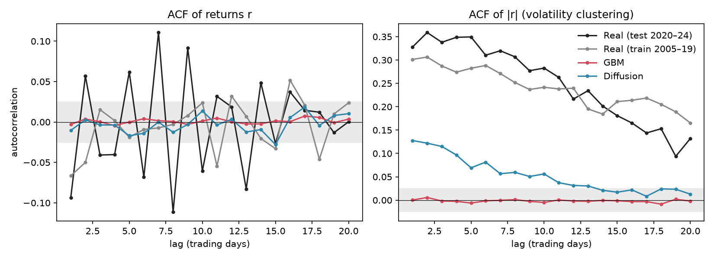

# Results

All numbers come from [`phase08_results.json`](phase08_results.json), written by `scripts/evaluate.py`. The reference is the **real 2020–2024 holdout**: 95 non-overlapping 64-day windows (6,080 returns), which neither generator saw. Both generators produce 2,000 windows. Returns are in per-ticker train-std units, so a value of 1.0 means "as volatile as the 2005–2019 training period".

## Headline: volatility clustering

Mean autocorrelation of |r| over lags 1 to 20. This is the check that separates a learned generative model from GBM.

| Source | Mean ACF(\|r\|) |
|--------|----------------|
| Real (test 2020–24) | **0.250** |
| GBM | -0.002 |
| Diffusion | **0.053** |

**Diffusion is clearly closer to real than GBM, but it captures only about a fifth of the real effect.** GBM sits on zero by construction, so the model has learned that volatility persists. It has not learned how strongly.

## Full table

| Source | Excess kurtosis | Skew | Mean \|ACF(r)\| | Mean ACF(\|r\|) | Mean ACF(r²) | Std | Wasserstein-1 to real test |
|--------|-----------------|------|-----------------|-----------------|--------------|-----|----------------------------|
| Real test | 8.446 | -0.195 | 0.051 | 0.250 | 0.233 | 1.166 | 0 |
| Real train | 13.177 | -0.032 | 0.025 | 0.240 | 0.180 | 1.004 | 0.128 |
| GBM | 0.021 | -0.004 | 0.003 | -0.002 | -0.002 | 1.001 | **0.146** |
| Diffusion | 6.499 | -0.312 | 0.009 | 0.053 | 0.032 | 0.606 | 0.352 |

## Success criteria from PLAN.md

| # | Criterion | Result |
|---|-----------|--------|
| 1 | Vol clustering (ACF of \|r\|) closer to real than GBM | **Pass** |
| 2 | Excess kurtosis closer to real than GBM | **Pass** (6.50 vs real 8.45; GBM 0.02) |
| 3 | Skew closer to real than GBM | **Pass** (-0.312 vs real -0.195; GBM -0.004) |
| 4 | Linear ACF no larger than real | **Pass** (0.009 vs real 0.051) |
| 5 | Wasserstein-1 distance to real below GBM's | **Fail** (0.352 vs GBM 0.146) |

Four of five pass. The failure is real and worth understanding.

## Why the diffusion model fails criterion 5

The samples are too quiet. Their standard deviation is **0.606**, against 1.0 in the training data and 1.17 in the test period. Wasserstein-1 compares whole distributions, so a model whose returns are about 40% too small is penalized heavily, even when its tails and clustering are the right shape. GBM is calibrated to the training standard deviation, so it gets the overall scale right and wins this metric despite having no tails at all.

This is a model-quality problem, not a regime shift: the diffusion samples are quieter than even the *training* data, so the gap is not explained by the test period being more volatile.

Skew deserves a caveat too. The diffusion model's skew (-0.312) overshoots the test target (-0.195). Training-period skew was only -0.032, so this is not a learned market feature. Treat the skew "pass" as weaker than it looks.

## Other training runs

Four configurations were trained. Run **r1** (20,000 steps, lr 2e-4, 64 channels) was selected by `scripts/select_run.py`, which scores runs against **train-period** data only (rule fixed before any run was evaluated). The holdout played no part in choosing. Its score was a near tie with r3, so the choice is not decisive. For transparency, all four on the holdout:

| Run | Std | Excess kurtosis | Skew | Mean ACF(\|r\|) | Wasserstein-1 |
|-----|-----|-----------------|------|-----------------|---------------|
| r1 · lr 2e-4, 20k steps (selected) | 0.606 | 6.499 | -0.312 | 0.053 | 0.352 |
| r2 · lr 1e-3, 40k steps | 0.566 | 14.073 | -0.422 | 0.093 | 0.394 |
| r3 · lr 1e-3, 40k steps, 128 channels | 0.473 | 36.378 | -0.558 | 0.193 | 0.492 |
| r4 · lr 2e-4, 60k steps | 0.552 | 10.067 | -0.312 | 0.064 | 0.398 |

Longer or more aggressive training moved the numbers in two directions at once. Volatility clustering got stronger (up to 0.193 in r3, nearer the real 0.250), but kurtosis overshot (36 in r3 against a real 8.4) and the samples got quieter still (std down to 0.47). **No run fixed the scale problem**, and none beat GBM on Wasserstein-1.

## Limits

- The holdout has only 95 windows, so its kurtosis and skew are noisy and driven by a handful of COVID days.
- 64-day windows only allow ACF lags up to 20. Long-memory volatility decay is not tested.
- One seed per configuration. The differences among r1, r2 and r4 are small enough that they may not survive a re-run.
- The unconditional model never sees regime information, and the per-ticker scaling uses training-period volatility only.
